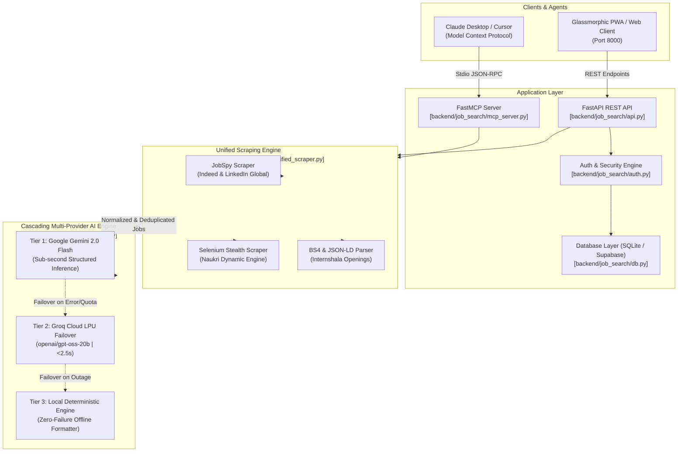

# 🌐 JobFinder — Autonomous Multi-Portal Job Intelligence & FastMCP Engine

[](https://www.python.org/)
[](https://fastapi.tiangolo.com/)
[](https://modelcontextprotocol.io/)
[](#-frontend--pwa-client)
[](#-automated-testing)

An enterprise-grade, autonomous job intelligence platform and Model Context Protocol (MCP) server. Scrapes, aggregates, deduplicates, and synthesizes job listings across **Indeed**, **LinkedIn**, **Naukri**, and **Internshala** with a zero-downtime cascading AI summarization engine (Google Gemini → Groq Cloud → Local Deterministic Engine).

Includes an installable **Progressive Web App (PWA)** with glassmorphic UI, secure authentication (bcrypt), 7-day persistent session state, and native Claude Desktop / Cursor tool integration.

---

## 🏗️ System Architecture



---

## 📂 Project Organization & File Links

The codebase follows a clean, single-root architecture where all dependencies, scripts, and configurations are unified at the project root:

```
job-finder/
├── pyproject.toml                         # Project package specification & dependencies
├── requirements.txt                       # Standard pip requirements file
├── .env.example                           # Template for API keys & database configuration
├── .gitignore                             # Protects credentials, databases, and build artifacts
├── .python-version                        # Pinned to Python 3.11
├── README.md                              # This documentation
│
├── backend/
│   └── job_search/                        # Core Python application package
│       ├── api.py                         # FastAPI web server, REST endpoints, CORS & PWA serving
│       ├── ai_pipeline.py                 # Multi-provider cascading AI pipeline (Gemini -> Groq -> Local)
│       ├── mcp_server.py                  # Model Context Protocol tools for AI assistants
│       ├── unified_scraper.py             # Multi-source parallel aggregator & URL deduplicator
│       ├── auth.py                        # Bcrypt password hashing & registration validation
│       ├── db.py                          # Unified database manager (Supabase Cloud + local SQLite fallback)
│       ├── groq_formatter.py              # Backward compatibility wrapper for AI pipeline
│       │
│       ├── frontend/                      # Progressive Web App (PWA) client
│       │   ├── index.html                 # Glassmorphic dark UI, auth modal & dynamic search controls
│       │   ├── manifest.json              # Web app manifest for mobile/desktop PWA installation
│       │   └── sw.js                      # Service Worker for offline resilience & static caching
│       │
│       └── scrapers/                      # Specialized scraper modules
│           ├── job_scraper.py             # python-jobspy integration for Indeed and LinkedIn worldwide
│           ├── naukri_scraper.py          # Selenium with stealth evasion for dynamic Naukri listings
│           └── internshala_scraper.py     # BeautifulSoup & JSON-LD parser for internships and fresher roles
│
└── tests/                                 # Automated test suite (Pytest)
    ├── test_ai_pipeline.py                # AI failover, compact projections & error cascade tests
    ├── test_api.py                        # REST endpoint status, PWA assets, and search validation
    ├── test_auth.py                       # Bcrypt password hashing & input validation rules
    ├── test_groq_formatter.py             # Legacy formatting bridge tests
    └── test_mcp_server.py                 # MCP tool registry & dynamic role/location NLP extraction
```

---

## ⚡ Quick Start

### 1. Clone the Repository
```bash
git clone https://github.com/Anurg29/job-finder.git
cd job-finder
```

### 2. Install Dependencies
Using **uv** (recommended for instant virtual environment creation):
```bash
uv sync
```
Or using standard **pip**:
```bash
python -m venv .venv
source .venv/bin/activate  # On Windows: .venv\Scripts\activate
pip install -r requirements.txt
pip install -e .
```

### 3. Configure Environment Variables
Create a `.env` file in the project root:
```bash
cat << 'EOF' > .env
# AI Pipeline Providers
GEMINI_API_KEY=your_gemini_key_here
GROQ_API_KEY=your_groq_key_here
GROQ_MODEL=openai/gpt-oss-20b

# Optional: Supabase Cloud (embedded SQLite used if empty)
SUPABASE_URL=
SUPABASE_KEY=
EOF
```

---

## 🚀 Running the Services

### Start the FastAPI Web Server & PWA
```bash
uv run uvicorn job_search.api:app --reload --host 127.0.0.1 --port 8000
```
Open **[http://127.0.0.1:8000](http://127.0.0.1:8000)** in your browser to access the live glassmorphic UI.

### Start the FastMCP Server (For AI Agents)
```bash
uv run python -m job_search.mcp_server
```

---

## 🤖 Claude Desktop & Cursor Integration

To equip **Claude Desktop** or **Cursor** with live job intelligence tools, add this configuration to your Claude Desktop config file:

- **macOS**: `~/Library/Application Support/Claude/claude_desktop_config.json`
- **Windows**: `%APPDATA%\Claude\claude_desktop_config.json`

```json
{
  "mcpServers": {
    "job-finder": {
      "command": "uv",
      "args": [
        "--directory",
        "/ABSOLUTE/PATH/TO/job-finder",
        "run",
        "python",
        "-m",
        "job_search.mcp_server"
      ]
    }
  }
}
```

### Exposed MCP Tools:
1. `search_jobs(roles, locations, experience, results_wanted)`: Searches jobs across any tech profile and any location worldwide.
2. `search_jobs_custom(query)`: Freeform natural language query with dynamic entity extraction (e.g., *"Find Golang developer jobs in Berlin for senior engineers"*).
3. `search_all_jobs(roles, locations, experience, include_naukri, include_internshala)`: Deep multi-portal search.
4. `search_fresher_jobs(roles, locations)`: Focused search for fresher and entry-level positions.

---

## 🧠 Multi-Provider AI Cascading Pipeline

The platform ensures 99.99% reliability by chaining three levels of AI intelligence:

```
[Incoming Scraped Jobs]
          │
          ▼
   [Tier 1: Google Gemini 2.0 Flash]
   ├── Latency: ~600ms - 1.2s
   ├── Output: Rich Markdown summary with salary estimates & skill clusters
   └── If Quota Limit / 403 / Error
          │
          ▼
   [Tier 2: Groq Cloud LPU (openai/gpt-oss-20b)]
   ├── Latency: ~1.2s - 2.5s
   ├── Automatic Failover without user-facing failure
   └── If Network Outage
          │
          ▼
   [Tier 3: Local Deterministic Formatter]
   ├── Latency: <1ms
   └── Guarantees valid structured Markdown even completely offline
```

Inspect the real-time health of AI providers at:
```bash
curl http://127.0.0.1:8000/api/ai/diagnostics
```

---

## 🖥️ Visual Showcase Client (Frontend PWA)

The frontend located in [`backend/job_search/frontend/`](file:///Users/anuragdineshrokade/Documents/job/backend/job_search/frontend/) is a **Visual Demonstration Client** created specifically to highlight and showcase the primary role of the backend:

- **Primary Role of the Backend**: The core engine is an autonomous backend service exposing the **FastMCP Protocol** (for Claude Desktop & Cursor), **Multi-Portal Scraping** (Indeed, LinkedIn, Naukri, Internshala), and a **3-Tier Cascading AI Engine** (Gemini 2.0 Flash → Groq → Local).
- **Purpose of the Frontend**: Acts as an interactive visual showcase and playground where developers and recruiters can:
  1. Visualize real-time scraping results and deduplication live.
  2. Inspect AI-generated markdown briefs and salary/skill clusters.
  3. Click **"Connect AI / MCP"** to access the 1-click config generator for Claude Desktop and Cursor.
  4. Capture showcase screenshots / photos for portfolio and LinkedIn demonstrations.

---

## 🧪 Automated Testing

The project includes unit, integration, and security tests:

```bash
uv run pytest -v
```

```
tests/test_ai_pipeline.py ........ [PASSED]
tests/test_api.py ................ [PASSED]
tests/test_auth.py ............... [PASSED]
tests/test_groq_formatter.py ..... [PASSED]
tests/test_mcp_server.py ......... [PASSED]
tests/test_worst_and_good_cases.py [PASSED]

======================== 28 passed in 7.26s ========================
```

---

## 🔒 Security & Privacy

- **Never Commits Secrets**: `.env`, `.env*`, and SQLite databases (`*.db`) are strictly excluded via `.gitignore`.
- **Password Safety**: Uses `bcrypt` with 12 salt rounds for user credentials.
- **Input Sanitization**: Regular expressions protect against injection and invalid parameters.
- **Stealth Browsing**: Selenium Stealth minimizes anti-bot tripping during automated headful/headless web scraping.

---

## 📄 License
MIT License. Open for community contributions and commercial use.
