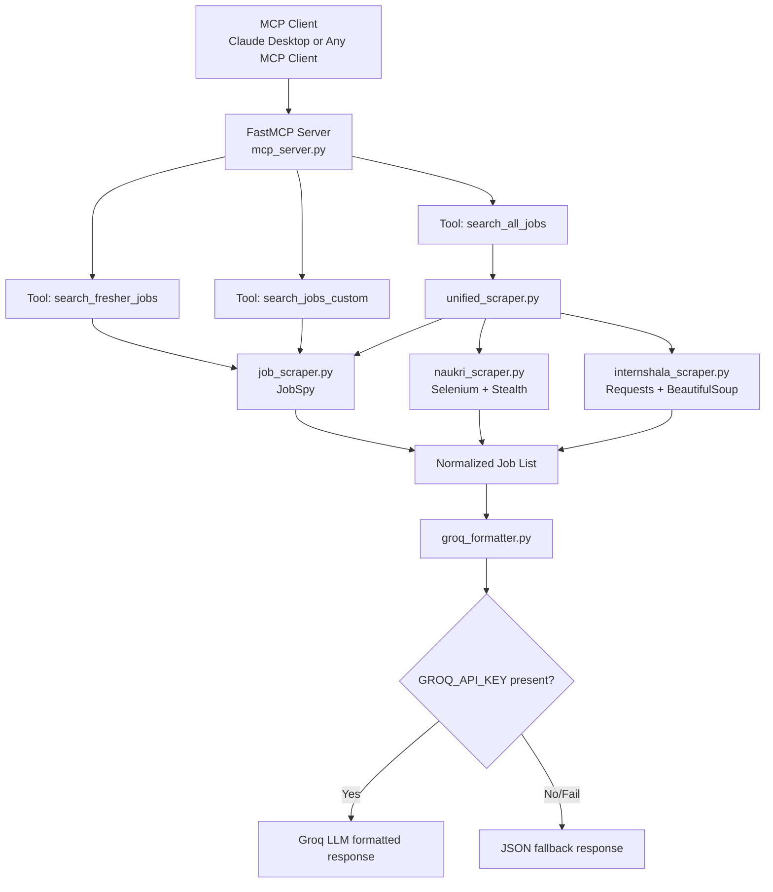
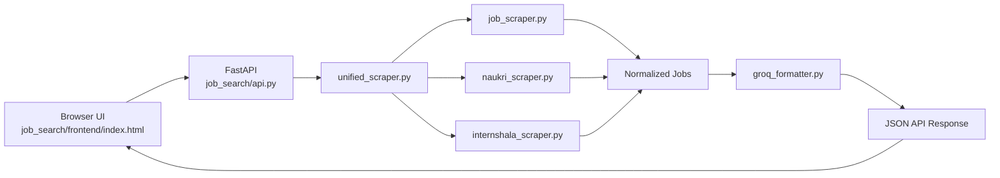

# Project Documentation: Job Search MCP Server

## 1) Project Purpose

This project is a local MCP server that exposes job-search tools to MCP clients (like Claude Desktop).

It collects jobs from:
- JobSpy-backed sites: Indeed, LinkedIn, Glassdoor
- Naukri (Selenium-based scraper)
- Internshala (requests + HTML/JSON-LD parsing)

Then it formats results:
- With Groq LLM response if `GROQ_API_KEY` is available
- With JSON fallback if Groq key is absent or API call fails

## 2) High-Level Architecture

```text
MCP Client (Claude Desktop)
        |
        v
   mcp_server.py (FastMCP tool registry + entrypoint)
        |
        +-------------------------------+
        |                               |
        v                               v
 search_fresher_jobs / search_jobs_custom / search_all_jobs
        |                               |
        |                               +--> unified_scraper.py
        |                                     |--> job_scraper.py (JobSpy)
        |                                     |--> naukri_scraper.py (Selenium)
        |                                     +--> internshala_scraper.py (requests/bs4)
        |
        +-------------> groq_formatter.py (final formatting)
                              |--> Groq API (if key)
                              +--> JSON fallback (if no key/error)
```

## 2.1 High-Level Diagram (Mermaid)



## 3) Directory Structure

```text
job/
  .env
  pyproject.toml
  uv.lock
  README.md
  docs/
    PROJECT_DOCUMENTATION.md
  job_search/
    __init__.py
    api.py
    mcp_server.py
    groq_formatter.py
    unified_scraper.py
    frontend/
      index.html
    scrapers/
      __init__.py
      job_scraper.py
      naukri_scraper.py
      internshala_scraper.py
```

## 4) Dependency and Runtime Model

Defined in `pyproject.toml`:
- Python >= 3.11
- Core runtime libs: `mcp`, `groq`, `python-dotenv`
- Job sources: `python-jobspy`, `selenium`, `selenium-stealth`, `webdriver-manager`

Environment model:
- Use `uv` with project-local `.venv`
- Always run with `uv run ...` or explicit `.venv/bin/python ...`
- Avoid creating extra `venv` folders; this project standard is `.venv`

## 5) End-to-End Request Flow

### A) `search_fresher_jobs(...)`
1. Client calls MCP tool.
2. `mcp_server.py` splits comma-separated roles and cities.
3. For each role, it calls `fetch_jobs(...)` in `job_scraper.py`.
4. Returned records are merged and deduplicated by `job_url`.
5. Query text is created and passed to `format_jobs_with_groq(...)`.
6. Response is returned as formatted markdown/JSON string.

### B) `search_jobs_custom(query)`
1. Query text is parsed for known city keywords.
2. Roles are inferred from query keywords (`python`, `ai`, `ml`).
3. `fetch_jobs(...)` is called role-wise.
4. Results are sent to formatter.
5. Formatted string is returned.

### C) `search_all_jobs(...)`
1. Inputs are parsed into role and city lists.
2. `search_all_portals(...)` is called.
3. For each role-city pair:
4. JobSpy fetch runs first.
5. Optional Naukri scrape runs if enabled.
6. Optional Internshala scrape runs if enabled.
7. Unified result list is deduplicated.
8. Final list is sent to formatter and returned.

## 6) File-by-File, Line-by-Line Explanation

## 6.1 `mcp_server.py`

Path: `job_search/mcp_server.py`

- Line 1: Import `FastMCP` framework.
- Line 2: Import base JobSpy fetch helper.
- Line 3: Import Groq/JSON formatter.
- Line 4: Import unified multi-source aggregator.
- Line 7: Create server instance named `"Job Search Server"`.

`search_fresher_jobs`:
- Lines 9-13: Register MCP tool and define default role/city input.
- Lines 14-21: Tool docstring and argument description.
- Lines 23-24: Split role and city CSV into lists.
- Line 26: Initialize accumulator.
- Lines 28-30: Fetch jobs role-by-role via JobSpy helper.
- Lines 33-38: Deduplicate by `job_url`.
- Line 40: Build human-readable query string.
- Line 41: Format result with Groq/fallback.
- Line 43: Return final string.

`search_jobs_custom`:
- Lines 46-47: Register second MCP tool.
- Lines 48-54: Docstring and input meaning.
- Lines 56-62: City keyword mapping.
- Lines 64-67: Parse city keywords from query; apply default cities if absent.
- Lines 70-76: Parse role intent from query; apply default role if absent.
- Lines 78-82: Fetch jobs for inferred roles.
- Line 83: Format and return.

`search_all_jobs`:
- Lines 86-93: Register multi-source tool with feature toggles.
- Lines 94-99: Docstring for included sources.
- Lines 100-101: Parse input role/city CSV.
- Lines 103-110: Execute unified pipeline with toggles and per-source page limits.
- Line 111: Format and return.

Entrypoint:
- Lines 114-115: `mcp.run()` when executed as script.

## 6.2 `unified_scraper.py`

Path: `job_search/unified_scraper.py`

- Lines 1-5: Import typing and all source adapters.

`_dedupe_jobs`:
- Lines 8-10: Prepare dedupe set + output list.
- Lines 12-13: Prefer `job_url` as unique key.
- Lines 14-19: Fallback key if URL missing (`title|company|location`).
- Lines 20-23: Keep first unique entry, drop duplicates.
- Line 25: Return deduped list.

`search_all_portals`:
- Lines 28-35: Function signature with source toggles and paging controls.
- Line 36: Output accumulator.
- Lines 38-40: Iterate role-city combinations and normalize city to `"City, India"`.
- Lines 42-50: Call JobSpy source adapter (Indeed/LinkedIn/Glassdoor).
- Lines 51-52: Log JobSpy errors without failing whole request.
- Lines 54-57: Optional Naukri scrape and append.
- Lines 58-59: Log Naukri errors.
- Lines 61-66: Optional Internshala scrape and append.
- Lines 67-68: Log Internshala errors.
- Line 70: Return deduped aggregated list.

## 6.3 `job_scraper.py`

Path: `job_search/scrapers/job_scraper.py`

- Line 1: Import `scrape_jobs` from JobSpy.
- Lines 4-10: Function signature with configurable sites/results/window.
- Lines 11-12: Default sites if none passed (`indeed`, `linkedin`).
- Line 14: Output list.
- Line 16: Iterate location list.
- Lines 18-25: Call JobSpy scrape API.
- Lines 27-37: Convert each DataFrame row into normalized dict schema.
- Line 35: Truncate description to first 500 chars.
- Line 38-39: Log and continue on source/location failure.
- Line 41: Return normalized list.

## 6.4 `naukri_scraper.py`

Path: `job_search/scrapers/naukri_scraper.py`

- Lines 1-9: Selenium and driver dependencies.
- Lines 12-13: `_slug` utility for URL-friendly segments.

`scrape_naukri`:
- Lines 16-22: Signature with paging/headless/stealth controls.
- Lines 23-28: Configure Chrome options.
- Lines 30-31: Auto-install/resolve Chromedriver and start browser.
- Lines 33-42: Apply stealth config to reduce bot detection.
- Line 44: Output list.
- Lines 46-48: Prepare URL slugs.
- Lines 50-54: Build Naukri search URL with fresher filter (`experience=0`).
- Lines 55-56: Open page and wait for content load.
- Lines 58-60: Try primary and fallback card selectors.
- Lines 62-92: Parse card fields safely and append normalized dict.
- Lines 93-94: Always close browser in `finally`.
- Line 96: Return parsed jobs.

## 6.5 `internshala_scraper.py`

Path: `job_search/scrapers/internshala_scraper.py`

- Lines 1-6: JSON parsing, URL handling, HTTP requests, BeautifulSoup.
- Lines 9-10: `_slug` helper for route-safe tokens.

`_candidate_urls`:
- Lines 13-22: Generate multiple URL patterns to improve resilience.

`_extract_from_json_ld`:
- Lines 25-27: Parse JSON-LD blocks from page.
- Lines 29-38: Load each `application/ld+json` safely.
- Lines 40-45: Normalize payload into iterable objects.
- Lines 46-51: Keep only `@type == JobPosting`.
- Lines 53-57: Read organization/company safely.
- Lines 59-68: Read location from nested address fields.
- Lines 70-81: Build normalized job entries.
- Line 83: Return parsed jobs.

`_extract_from_html`:
- Lines 86-90: Fallback parser if JSON-LD missing.
- Lines 92-95: Extract title and href from job anchors.
- Lines 96-101: Best-effort company extraction from nearby container.
- Lines 103-114: Build normalized fallback entries.
- Line 116: Return fallback parsed jobs.

`scrape_internshala`:
- Lines 119-126: Set function signature and browser-like User-Agent.
- Lines 128-129: Initialize output + dedupe set.
- Lines 131-147: Try candidate URLs page-wise and parse first successful response.
- Lines 148-153: Deduplicate by `job_url`.
- Line 155: Return accumulated results.

## 6.6 `groq_formatter.py`

Path: `job_search/groq_formatter.py`

- Lines 1-6: Imports for JSON, env, dotenv, and Groq client.
- Lines 8-9: Resolve project-root `.env` path and load variables.

`_compact_jobs`:
- Lines 11-24: Keep top `limit` jobs and project them to essential fields.

`format_jobs_with_groq`:
- Lines 27-29: Early return when no jobs found.
- Line 31: Read `GROQ_API_KEY`.
- Line 32: Compact large results before formatting.
- Lines 34-37: JSON fallback path if key missing.
- Lines 39-47: Build prompt with query + compact job list.
- Lines 49-58: Call Groq chat completion API.
- Lines 59-60: Return generated markdown text.
- Lines 61-68: On Groq/API failure, return informative JSON fallback.

## 6.7 `pyproject.toml`

Path: `pyproject.toml`

- Lines 1-6: Project metadata and Python version floor.
- Lines 7-15: Runtime dependency list used by `uv sync`.

## 7) Data Contract Used Across Scrapers

Each scraper returns list of dicts with this normalized schema:
- `title`
- `company`
- `location`
- `date_posted`
- `job_url`
- `source`
- `description`
- `min_exp`

This schema allows:
- Shared dedupe logic
- Shared formatter logic
- Source-agnostic MCP tool outputs

## 8) Runtime/Execution Instructions

## 8.1 Install / Sync

```bash
cd /Users/anuragdineshrokade/Documents/job
uv sync
```

## 8.2 Run MCP Server

```bash
cd /Users/anuragdineshrokade/Documents/job
uv run python -m job_search.mcp_server
```

## 8.3 Claude Desktop MCP Config (Recommended)

Use project venv interpreter directly:

```json
{
  "mcpServers": {
    "job-search": {
      "command": "/Users/anuragdineshrokade/Documents/job/.venv/bin/python",
      "args": ["-m", "job_search.mcp_server"],
      "env": {
        "GROQ_API_KEY": "your_real_key"
      }
    }
  }
}
```

## 9) Known Limitations

- Scraping selectors may break when site HTML changes.
- Naukri anti-bot protections can intermittently block headless traffic.
- Internshala URL patterns may vary over time by role/location.
- Source coverage quality can vary by time window and search phrase.
- There is currently no persistent storage/cache layer.

## 10) Recommended Next Improvements

1. Add structured logging instead of `print(...)`.
2. Add retries + backoff + per-source timeout strategy.
3. Add optional cache (Redis/SQLite) and daily refresh scheduling.
4. Add tests for parser functions with sample HTML fixtures.
5. Add rate limiting and proxy configuration hooks.
6. Add source-wise metrics in response (counts, failures, latency).

## 11) Claude Desktop Local Runtime Flow

This section explains exactly how your project runs locally with Claude Desktop.

### 11.1 Startup Sequence

1. Claude Desktop starts and loads:
   - `~/Library/Application Support/Claude/claude_desktop_config.json`
2. It sees MCP entry `job-search`.
3. It launches the process:
   - `/Users/anuragdineshrokade/Documents/job/.venv/bin/python`
   - `-m job_search.mcp_server`
4. `mcp_server.py` creates `FastMCP("Job Search Server")` and registers all `@mcp.tool()` functions.
5. Claude now detects these tools and can invoke them from chat.

### 11.2 Request Handling Sequence

1. You ask a job query in Claude Desktop.
2. Claude decides to call one of your local tools.
3. Tool executes inside your local Python process.
4. Scraper pipeline runs:
   - JobSpy (Indeed/LinkedIn/Glassdoor)
   - Optional Naukri
   - Optional Internshala
5. Results are normalized and deduplicated.
6. Formatter creates final output:
   - Groq-formatted markdown if key exists
   - JSON fallback if key missing or API fails
7. Tool response is returned to Claude chat.

### 11.3 Required Local Preconditions

1. `.venv` exists and dependencies are synced:
   - `uv sync`
2. `.env` contains valid key (if Groq formatting needed):
   - `GROQ_API_KEY=...`
3. MCP config uses `.venv/bin/python`, not system `python`.
4. Claude Desktop is restarted after config changes.

### 11.4 Minimal Working Config

```json
{
  "mcpServers": {
    "job-search": {
      "command": "/Users/anuragdineshrokade/Documents/job/.venv/bin/python",
      "args": ["-m", "job_search.mcp_server"],
      "env": {
        "GROQ_API_KEY": "your_real_key"
      }
    }
  }
}
```

### 11.5 Quick Verification

1. Local import check:
```bash
cd /Users/anuragdineshrokade/Documents/job
uv run python -c "import mcp, groq, jobspy, dotenv; print('ok')"
```
2. Manual server run check:
```bash
uv run python -m job_search.mcp_server
```
3. Claude test prompt:
   - `Show me fresher Python jobs in Hyderabad from all sources`

## 12) Running Locally Without Claude

Yes, you can run it without Claude.

Important detail:
- MCP is a client-server protocol.
- Your `mcp_server.py` is the server.
- To actually call tools via MCP protocol, you need any MCP client (not only Claude).

### 12.1 Run Server Process Only

```bash
cd /Users/anuragdineshrokade/Documents/job
uv run python -m job_search.mcp_server
```

This confirms server startup, but by itself it does not execute tools until a client connects.

### 12.2 Test Business Logic Without MCP Client

You can call tool functions directly from Python:

```bash
cd /Users/anuragdineshrokade/Documents/job
uv run python - <<'PY'
from job_search.mcp_server import search_all_jobs

result = search_all_jobs(
    query="Python fresher jobs in Hyderabad",
    roles="Python Developer",
    cities="Hyderabad",
    include_naukri=False,
    include_internshala=True,
)
print(result[:1200])
PY
```

### 12.3 Test via Local MCP CLI Client (Optional)

Your current environment has `mcp` runtime package but not CLI extras.

Install CLI extra:

```bash
cd /Users/anuragdineshrokade/Documents/job
uv add "mcp[cli]"
```

Then you can use MCP CLI commands for local protocol-level testing.

## 13) Standalone Web App Architecture (Without Claude)

New files:
- `job_search/api.py` (FastAPI backend)
- `job_search/frontend/index.html` (browser UI)

Flow:
1. Browser opens `http://127.0.0.1:8000/`
2. FastAPI serves `job_search/frontend/index.html`
3. Frontend sends `POST /api/search`
4. Backend calls `search_all_portals(...)`
5. Backend formats output with `format_jobs_with_groq(...)`
6. Backend returns JSON
7. Frontend renders cards and summary

Mermaid:



Run command:

```bash
cd /Users/anuragdineshrokade/Documents/job
uv run uvicorn job_search.api:app --reload --host 127.0.0.1 --port 8000
```
